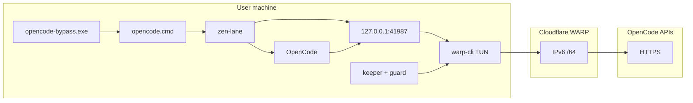
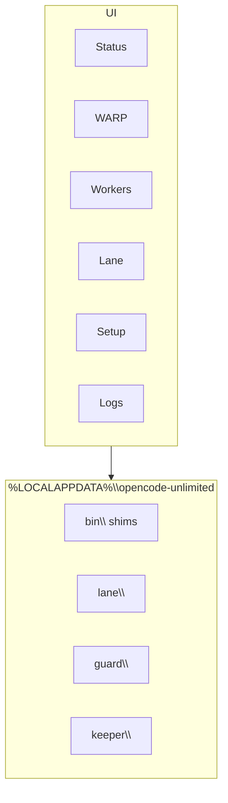

# opencode-bypass

Windows control panel for OpenCode CLI and Desktop that runs traffic over a Cloudflare WARP IPv6 path, so the free plan limit can be reset as many times as you want.

The free tier counts usage against your client address. `--hop` drops WARP, reconnects, and comes back on a new `/64`. New address, new counter, limit gone. Nothing to sign up for, no accounts to rotate, no waiting for a reset window.

Single binary: Nuklear UI, lane proxy, background workers, and install shims under `%LOCALAPPDATA%\opencode-unlimited\`.

## What it does

| Area | Behavior |
|------|----------|
| **Shims** | Installs `opencode.cmd`, `opencode-desktop.cmd` and helper scripts in user `bin`, then prepends that folder to `Path`. |
| **WARP** | Finds `warp-cli.exe`, registers if needed, sets mode `warp`, connects TUN, shows adapter and egress IPv6 in the UI. |
| **Lane** | Starts a local dual-stack proxy, sets `HTTPS_PROXY` for OpenCode, reads edge override / blacklist / strict mode from `lane\`. |
| **Workers** | **Keeper** rotates WARP egress. **Guard** tracks hops and coordinates rerolls (`--worker keeper` / `--worker guard`). |
| **Desktop service** | Can point OpenCode Desktop at the local proxy through `service.json`. |
| **Firewall (optional)** | Killswitch helpers via `ouc_firewall`. |
| **Tasks** | Optional logon Scheduled Tasks for keeper and guard. |

A hop disconnects WARP, reconnects, and writes both the old and the new `/64` into `guard/state.json`, where the blacklist and lane reroll logic pick it up.

## Architecture





## Requirements

- Windows 10 or 11, x64
- Administrator rights, the manifest is `requireAdministrator`
- [Cloudflare WARP](https://developers.cloudflare.com/warp-client/) with `warp-cli.exe` on the machine
- OpenCode CLI or Desktop installed
- To build: Visual Studio 2022, MSVC, Windows SDK

## Install

1. Grab a build from [Releases](https://github.com/dekus/opencode-bypass/releases) or compile it yourself (see Build).
2. Start `opencode-bypass.exe`, accept the UAC prompt.
3. Go to **Setup**, hit **Install / Repair** once.
4. Open a new terminal. `opencode` now resolves to the shim, which runs it through `--lane`.

From there the **WARP** tab is the reset button. Hop whenever you need. If you would rather not press it yourself, enable **keeper** in the **Workers** tab and it rotates on a timer.

## CLI

| Command | Role |
|---------|------|
| `opencode-bypass.exe` | Control panel |
| `opencode-bypass.exe --worker keeper` | Rotation worker |
| `opencode-bypass.exe --worker guard` | Guard worker |
| `opencode-bypass.exe --lane ...` | Run OpenCode through lane and proxy |
| `opencode-bypass.exe --hop` | One hop to a fresh `/64` |
| `opencode-bypass.exe --doctor` | Health check |
| `opencode-bypass.exe --firewall ...` | Firewall helpers |

Manual reset when the free plan stalls:

```bat
opencode-bypass.exe --hop
```

Continuous rotation in the background:

```bat
opencode-bypass.exe --worker keeper
```

## Repository layout

```text
opencode-bypass/
  LICENSE
  README.md
  source/
    opencode-bypass.sln
    features/       lane, network, ui, misc
    ouc-common/
    ouc-firewall/
    vendor/         nuklear, nlohmann/json
```

## Build

1. Open `source/opencode-bypass.sln`.
2. Select **Release | x64**.
3. Build. Output lands in `source/bin/opencode-bypass.exe`.

The UI is Nuklear on Direct3D 11. No installer, the binary is self-contained.

## Configuration

Everything lives in `%LOCALAPPDATA%\opencode-unlimited\`.

| File | Purpose |
|------|---------|
| `lane/edge_override.txt` | Edge hostname, or `auto` |
| `lane/last_edge.txt` | Last pinned edge |
| `lane/strict_proxy.flag` | Require proxy for the lane |
| `lane/edge_reroll` | Reroll trigger |
| `guard/state.json` | Hops, blacklist, egress metadata |
| `keeper.pause` | Pause keeper while you hop by hand |

`OUC_SERVICE_PROXY_PORT` overrides the default port `41987`.

## UI tabs

| Tab | Actions |
|-----|---------|
| **Status** | WARP, workers, proxy, firewall, desktop wiring. Refresh, copy egress |
| **WARP** | Hop `/64`, connect, disconnect |
| **Workers** | Keeper, guard, desktop service, autostart, firewall |
| **Lane** | Edge override, pool, strict mode, blacklist |
| **Setup** | Install / repair, uninstall, launch apps, open logs folder |
| **Logs** | Guard, keeper and OpenCode tails |

## Troubleshooting

| Symptom | Check |
|---------|-------|
| UI exits immediately | Run elevated, check Event Viewer |
| No WARP | Client installed, `warp-cli` path correct |
| Shim missing | Run Install / Repair, open a new terminal |
| Proxy down | Port 41987 is free |
| Status stays empty | Hit Refresh |
| Hop does nothing | `warp-cli` reachable, TUN active, keeper paused |

```bat
opencode-bypass.exe --doctor
```

## Notes

- WARP addresses get burned over time. That is what the blacklist and guard worker are for, don't disable both and expect the same `/64` to keep working.
- Routing through WARP adds latency. Fine for prompts and edits, noticeable on large streams.
- This changes where requests come from, not what the plan allows. Paid models stay paid.
- Firewall helpers are optional and can cut off your own connectivity if you misconfigure them. Keep the CLI around.

## License

MIT. See [LICENSE](LICENSE). Third-party code under `source/vendor/` keeps its own terms.
