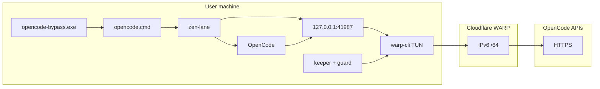
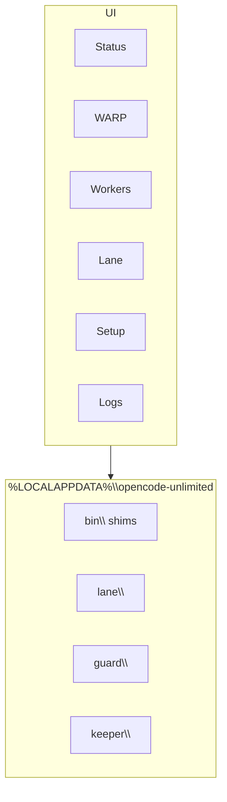

# Opencode Bypass

Native Windows control center for OpenCode CLI and Desktop over a Cloudflare WARP IPv6 path. One `opencode-bypass.exe` binary: Nuklear UI, lane proxy, background workers, and install shims under `%LOCALAPPDATA%\opencode-unlimited\`.

---

## What it does

| Area | Behavior |
|------|----------|
| **Shims** | Installs `opencode.cmd`, `opencode-desktop.cmd`, and helper scripts in user `bin`, then prepends that folder to `Path`. |
| **WARP** | Locates `warp-cli.exe`, registers if needed, mode `warp`, TUN connect, adapter and egress IPv6 in the UI. |
| **Lane** | Starts a local dual-stack proxy, sets `HTTPS_PROXY` for OpenCode, reads edge override / blacklist / strict mode under `lane\`. |
| **Workers** | **Keeper** rotates WARP egress; **Guard** tracks hops and coordinates rerolls (`--worker keeper` / `--worker guard`). |
| **Desktop service** | Can wire OpenCode Desktop to the local proxy via `service.json`. |
| **Firewall (optional)** | Killswitch helpers through `ouc_firewall`. |
| **Tasks** | Optional logon Scheduled Tasks for keeper and guard. |

**Hop /64** disconnects WARP, reconnects, and logs the old and new /64 in `guard/state.json` for blacklist and lane rerolls.

---

## Architecture





---

## Repository layout

```
opencode-bypass/
  LICENSE
  README.md
  source/
    opencode-bypass.sln
    features/       lane, network, ui, misc
    ouc-common/
    ouc-firewall/
    vendor/           nuklear, nlohmann/json
```

Prebuilt Windows x64 builds are attached to [Releases](https://github.com/dekus/opencode-bypass/releases).

---

## Requirements

- Windows 10 or 11, x64
- Run as Administrator (`requireAdministrator`)
- Visual Studio 2022, MSVC, Windows SDK (build from source)
- [Cloudflare WARP](https://developers.cloudflare.com/warp-client/) with `warp-cli.exe`
- OpenCode CLI or Desktop installed

---

## Usage

### GUI

Run `opencode-bypass.exe` from a Release build (UAC). Borderless Nuklear window with custom title controls. Run **Setup → Install / Repair** once.

### CLI

| Command | Role |
|---------|------|
| `opencode-bypass.exe` | Control center |
| `opencode-bypass.exe --worker keeper` | Rotation worker |
| `opencode-bypass.exe --worker guard` | Guard worker |
| `opencode-bypass.exe --lane …` | OpenCode via lane + proxy |
| `opencode-bypass.exe --hop` | One-shot /64 hop |
| `opencode-bypass.exe --doctor` | Health check |
| `opencode-bypass.exe --firewall …` | Firewall helpers |

After install, `opencode` in a new terminal uses the shim (`--lane`).

---

## Build

1. Open `source/opencode-bypass.sln`.
2. **Release | x64**.
3. Output: `source/bin/opencode-bypass.exe`.

UI: Nuklear + Direct3D 11.

---

## Config files

| File | Purpose |
|------|---------|
| `lane/edge_override.txt` | Edge hostname or `auto` |
| `lane/last_edge.txt` | Last pinned edge |
| `lane/strict_proxy.flag` | Require proxy for lane |
| `lane/edge_reroll` | Reroll trigger |
| `guard/state.json` | Hops, blacklist, egress metadata |
| `keeper.pause` | Pause keeper during manual hop |

`OUC_SERVICE_PROXY_PORT` overrides default port `41987`.

---

## UI tabs

| Tab | Actions |
|-----|---------|
| **Status** | WARP, workers, proxy, firewall, desktop wiring; refresh, copy egress |
| **WARP** | Hop /64, connect, disconnect |
| **Workers** | Keeper/guard, desktop service, autostart, firewall |
| **Lane** | Edge override, pool, strict mode, blacklist |
| **Setup** | Install/repair, uninstall, launch apps, logs folder |
| **Logs** | Guard, keeper, OpenCode tails |

---

## Troubleshooting

| Symptom | Check |
|---------|--------|
| UI exits early | Elevated run; Event Viewer |
| No WARP | Install client; `warp-cli` path |
| Shim missing | Install / Repair; new terminal |
| Proxy down | Port 41987 free |
| Empty status | Refresh in UI |

```bat
opencode-bypass.exe --doctor
```

---

## License

MIT. See [LICENSE](LICENSE). Third-party code in `source/vendor/` keeps its own terms.
