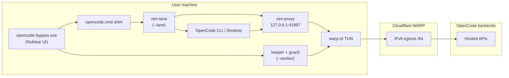
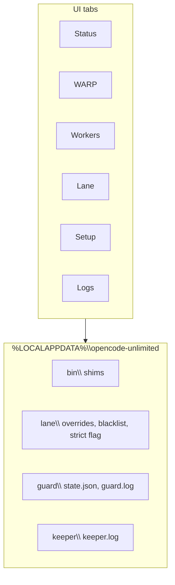

# Opencode Bypass

Windows control plane for running the OpenCode client on a Cloudflare WARP IPv6 egress path, with a local lane proxy, background workers, and a native Nuklear UI. The C++ tree in this package is a port of the original Python stack (`Open-source/src`), built as a single executable with the same CLI surface and install layout.

This repository is meant for **study, interoperability testing, and defensive research**. It is not a substitute for the OpenCode terms of service. Do not use it to evade billing or quotas on systems you do not own or operate.

---

## What the program does

Opencode Bypass wires your machine so that OpenCode CLI and Desktop traffic can leave through a controlled IPv6 prefix on WARP, while optional components keep that path alive, rotate it, and pin traffic to specific resolver edges. The GUI and the **Install / Repair** flow automate:

| Area | Behavior |
|------|----------|
| **Shims** | Drops `opencode.cmd`, `opencode-desktop.cmd`, and helper scripts under `%LOCALAPPDATA%\opencode-unlimited\bin` and prepends that folder to the user `Path`. |
| **WARP** | Finds `warp-cli.exe`, registers if needed, sets mode `warp`, connects TUN, and exposes adapter / egress IPv6 in the UI. |
| **Lane** | Runs `zen_lane`: starts a local dual-stack proxy, sets `HTTPS_PROXY` for the child OpenCode process, and honors edge override / blacklist / strict mode files under `lane\`. |
| **Workers** | **Keeper** rotates WARP egress on a schedule; **Guard** watches state and coordinates hops. Both are spawned with `--worker keeper` or `--worker guard`. |
| **Desktop service** | Can point the OpenCode Desktop Windows service at the local proxy (`service.json` under `.config/opencode/`). |
| **Firewall (optional)** | Installs a killswitch profile via `ouc_firewall` so only approved paths are used when enabled. |
| **Tasks** | Registers logon Scheduled Tasks for keeper and guard. |

Nothing here is magic against server-side enforcement by itself. The tooling assumes a model where **client-visible egress identity** (IPv6 /64, Cloudflare edge, proxy path) matters for how sessions are classified. Researchers use stacks like this to reproduce how desktop clients behave under different egress conditions. Operators use it to run OpenCode on a network they control end to end.

---

## Architecture





**Hop /64** (`zen_hop` or UI button) disconnects WARP, waits briefly, reconnects, and records the previous and new egress prefix in `guard/state.json` (hop counter and blacklist support lane rerolls).

---

## Why this class of tooling exists (research framing)

Many desktop AI clients talk to cloud APIs over HTTPS. When enforcement is partly tied to **network context** (egress IP family, prefix stability, or datacenter classification), changing that context changes what the server sees on the first hop. WARP in TUN mode gives you a Cloudflare-announced IPv6 path; rotating the /64 or pinning a chosen AAAA edge is an operational way to study:

- How often the client reuses the same egress label
- Whether limits track prefix, session cookie, account, or a combination
- What happens when Desktop uses a local MITM-style proxy vs direct egress

This project **automates** those experiments. It does **not** document a specific undisclosed CVE step by step. If you publish findings, follow coordinated disclosure with the vendor whose limits you tested.

---

## Package layout

```
opencode-bypass-github/
  README.md          (this file)
  release/
    opencode-bypass.exe
  source/
    opencode-bypass.sln
    features/          lane, network, ui, misc
    ouc-common/        paths, WARP, process helpers
    ouc-firewall/
    vendor/            nuklear, nlohmann/json, lazy-importer, xorstr
```

Reference Python sources (same logic, WebView UI) live in the parent repo under `Open-source/src/`.

---

## System requirements

- Windows 10 or 11, x64
- Administrator elevation (manifest: `requireAdministrator`)
- Visual Studio 2022 with MSVC and Windows SDK (to build from `source/`)
- [Cloudflare WARP](https://developers.cloudflare.com/warp-client/) (`warp-cli.exe`) for tunnel features
- OpenCode CLI or Desktop installed in a standard location (see `ouc_find_opencode_cli` / desktop discovery)

---

## Running

### Graphical UI

Launch `release/opencode-bypass.exe` (accept the UAC prompt). The window is borderless: title bar, minimize, maximize, and close are drawn inside Nuklear. Use **Setup → Install / Repair** once to deploy shims and tasks.

### Command-line modes

Same binary as the UI; no arguments opens the GUI.

| Invocation | Role |
|------------|------|
| `opencode-bypass.exe` | Nuklear control center |
| `opencode-bypass.exe --worker keeper` | Background WARP rotation worker |
| `opencode-bypass.exe --worker guard` | Guard worker |
| `opencode-bypass.exe --lane [args…]` | Run OpenCode through lane + proxy |
| `opencode-bypass.exe --hop` | One-shot /64 hop |
| `opencode-bypass.exe --doctor` | Console health check |
| `opencode-bypass.exe --firewall …` | Firewall killswitch helpers |

After install, use `opencode` from a new shell; it resolves to the shim, which calls this executable with `--lane`.

---

## Building from source

1. Open `source/opencode-bypass.sln` in Visual Studio.
2. Select **Release** and **x64**.
3. Build the solution.
4. Output: `source/bin/opencode-bypass.exe` (path may mirror your MSBuild `OutDir`).

Nuklear renders with Direct3D 11 (`d3d11.lib`, `dxgi.lib`). WebView2 is not required for this port.

---

## Configuration files

| Path | Purpose |
|------|---------|
| `lane/edge_override.txt` | Force a resolver edge or `auto` |
| `lane/last_edge.txt` | Last pinned edge |
| `lane/strict_proxy.flag` | Refuse non-proxied lane starts when present |
| `lane/edge_reroll` | Timestamp trigger for reroll |
| `guard/state.json` | Hops, blacklist, last egress metadata |
| `keeper.pause` | Pause keeper during UI-driven hops |

Environment variable `OUC_SERVICE_PROXY_PORT` overrides the default proxy port `41987`.

---

## UI map

| Tab | Actions |
|-----|---------|
| **Status** | Live dots for WARP, workers, proxy, firewall, desktop wiring; refresh and copy egress |
| **WARP** | Hop /64, connect, disconnect |
| **Workers** | Start/stop keeper and guard, wire desktop service, autostart, firewall |
| **Lane** | Edge override, pool refresh, strict mode, blacklist |
| **Setup** | Install/repair, uninstall, launch Desktop/CLI, open logs folder |
| **Logs** | Tail guard, keeper, or OpenCode logs |

---

## Legal and ethics

You are responsible for compliance with OpenCode, Cloudflare, and local law. Use only on accounts and networks you are allowed to test. The authors provide no warranty. Redistribution of `release/opencode-bypass.exe` must respect third-party licenses in `source/vendor/`.

---

## Credits and lineage

- Original Windows bundle analysis: see `Open-source/RECOVERY.md` in the parent repository.
- Python reference: `Open-source/src/` (`avatar_ui.py`, `zen_lane.py`, `warp_keeper.py`, `zen_guard.py`, `zen_proxy.py`, `zen_hop.py`, `doctor.py`, `ouc_common.py`, `ouc_firewall.py`).
- C++ port: Nuklear + D3D11 UI, `opencode_bypass_*` API aligned with the Python control center.

---

## Quick troubleshooting

| Symptom | Check |
|---------|--------|
| UI closes immediately | Run from an elevated prompt once; see Event Viewer for `opencode-bypass.exe` faults |
| WARP disconnected | Install WARP client; confirm `warp-cli` on PATH or default install dir |
| Shim not found | **Install / Repair** and open a **new** terminal after PATH update |
| Proxy down | Port `41987` free; worker or lane not already bound |
| Empty status fields | Click **Refresh**; confirm workers if you rely on background egress cache |

For a console report, run:

```bat
opencode-bypass.exe --doctor
```
